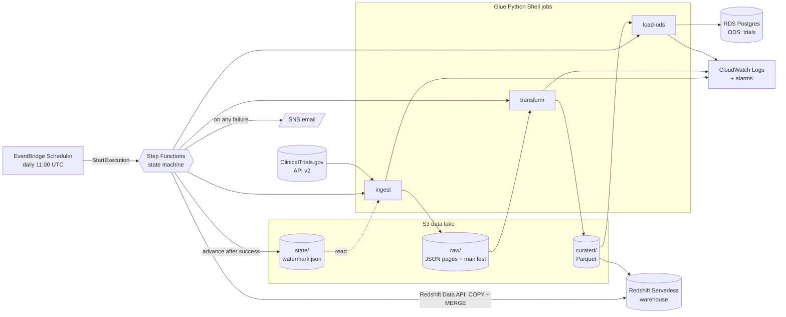
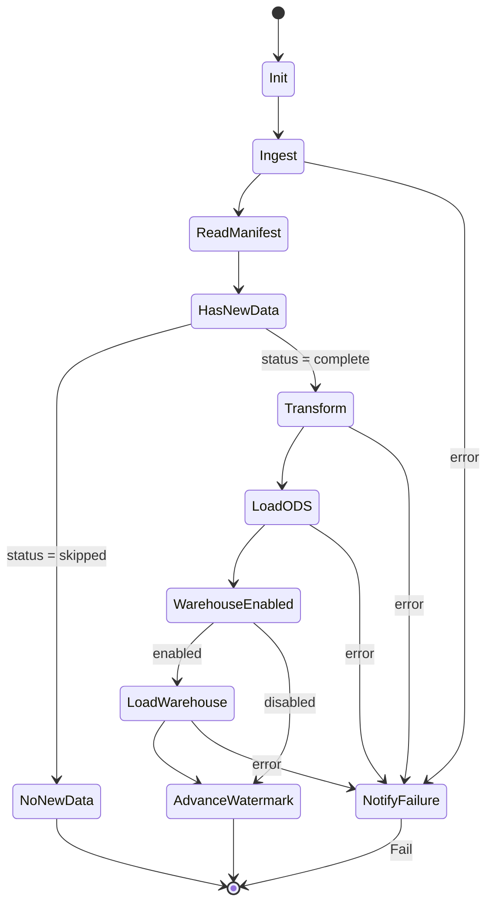

# HLD — Clinical-Trials Data Pipeline on AWS

High-level design for the whole pipeline. Low-level detail (schemas, state machine definition, IAM, Terraform)
is in [lld.md](lld.md). Decisions come from [design.md](design.md).

## 1. Goal
Every day, pull new and updated clinical trials from the public **ClinicalTrials.gov API v2**. Keep an
immutable raw copy, publish a clean curated dataset, keep a current-state operational database, and
(optionally) load an analytics warehouse. The pipeline is fully serverless, scheduled, alerting, and created
and destroyed with Terraform.

**Non-goals:** real-time/streaming, a multi-environment setup (dev/stage/prod), high availability for the
database, a UI. This is a portfolio-scale system built to production patterns.

## 2. Architecture

## 3. Components

| Component | AWS service | Responsibility |
|-----------|-------------|----------------|
| Scheduler | EventBridge Scheduler | Starts one execution per day after the registry's ~10:00 UTC refresh. |
| Orchestrator | Step Functions (Standard) | Runs the steps in order, retries, skips no-op days, sends failure alerts, advances the watermark last. |
| Ingest | Glue Python Shell | Checks registry freshness, pulls only the changed trials, writes raw pages and a manifest, checks the record count. **Code done:** `src/fetch.py`, `src/state.py`. |
| Transform | Glue Python Shell | Flattens raw JSON into one typed row per trial, de-duplicates, writes Parquet. `src/normalize.py` (to build). |
| Load ODS | Glue Python Shell (in VPC) | Inserts or updates the curated rows in Postgres by `nct_id`. `src/load_ods.py` (to build). |
| Load warehouse | Redshift Data API (direct from Step Functions) | COPY the day's Parquet into a staging table, then MERGE into `trials`. |
| Data lake | S3 | `raw/`, `curated/`, `state/`, `artifacts/` (code). Encrypted, no public access. |
| ODS | RDS Postgres (db.t4g.micro) | Current state of each trial, for apps and the RAG chatbot. |
| Warehouse | Redshift Serverless | Analytics and BI queries. Optional; turned on and off with a Terraform flag. |
| Alerting | SNS → email | Failure details (step, error, run date). |
| Observability | CloudWatch Logs, Step Functions history, CloudWatch alarm | Per-job logs; a visual history of each run; an alarm if an execution fails or times out. |
| Secrets | Secrets Manager | RDS password. No secrets in code or job arguments. |
| IaC | Terraform | Everything above; `apply` to create, `destroy` to tear down. |

## 4. Data flow and layers

| Layer | Location | Format | Contents | Written by |
|-------|----------|--------|----------|------------|
| Raw | `s3://<bucket>/raw/date=YYYY-MM-DD/` | JSON pages + `_manifest.json` | Full study records exactly as the API returned them. Never modified. | ingest |
| Curated | `s3://<bucket>/curated/date=YYYY-MM-DD/` | Parquet | One typed row per trial (the curated schema in LLD §4). | transform |
| ODS | RDS `public.trials` | Postgres table | Latest version of every trial ever loaded. | load-ods |
| Warehouse | Redshift `public.trials` | Columnar table | Same as the ODS, for analytics. | Step Functions → Data API |
| State | `s3://<bucket>/state/watermark.json` | JSON | How far we've loaded. | Step Functions (last step) |

**One daily run:**
1. **Check freshness.** If the registry hasn't refreshed since the last load, write a "skipped" manifest and end
   the run successfully.
2. **Ingest.** Pull trials updated since the watermark minus 2 days. Write each page to raw and check the count.
3. **Transform.** Turn that day's raw pages into a curated Parquet file.
4. **Load ODS.** Insert or update each trial by `nct_id`, keeping whichever version is newer.
5. **Load warehouse** (optional). COPY into staging, then MERGE.
6. **Advance the watermark.** Only reached if steps 2–5 succeed.

## 5. Orchestration (overview)

- **How steps share data:** through S3, not job outputs (Glue jobs can't return values to Step Functions).
  Every step works on the same `run_date` partition. The state machine reads `_manifest.json` directly with
  the built-in S3 integration.
- **Retries:** Step Functions owns all retries; the Glue jobs' own `MaxRetries` is 0. Short-lived Glue errors
  (concurrency, service errors) are retried with backoff. A failed job is retried once after 5 minutes. A data
  problem (`CountMismatchError`) fails the run and alerts.
- **No overlapping runs:** each Glue job allows only one run at a time (`MaxConcurrentRuns = 1`).
- **Re-runs and backfills:** start an execution by hand with a `scheduled_time`. Every step is safe to repeat
  (details in §6).

## 6. Non-functional design

| Concern | How it's met |
|---------|--------------|
| **Safe to re-run** | Raw and curated partitions are rewritten in full for a `run_date`. The ODS and warehouse insert or update by `nct_id` and only replace a row with a newer version. The watermark moves only at the very end. Re-running any day gives the same result. |
| **Completeness** | `totalCount` from the API is checked against records received. The manifest records the data version, query window, counts and files. |
| **Recovery** | A failed day leaves the watermark unchanged, so the next run re-pulls the window. The 2-day overlap also covers late updates. |
| **Reliability** | Polite request pacing to the API (~45 req/min), `Retry-After`, backoff with jitter; Step Functions retries; a 2-hour limit per execution. |
| **Observability** | Step Functions execution graph, CloudWatch Logs per job, manifest per run, SNS email on failure, CloudWatch alarm on `ExecutionsFailed`/`ExecutionsTimedOut`. |
| **Security** | Least-privilege IAM role per service; S3 encryption and no public access; RDS and Redshift in private subnets; DB password in Secrets Manager; no NAT gateway, and only the ingest job can reach the internet. |
| **Cost** | Serverless, paid per use. Glue at 1/16 DPU; RDS free tier; Redshift paid only while queries run; `terraform destroy` after sessions. Roughly cents per day (LLD §11). |
| **Scale** | About 1–3k changed trials a day (~20–60 MB of raw JSON) fits easily in a Python Shell job. A full 500k-trial backfill is a one-off, done with several date-windowed runs. |

## 7. Key decisions and alternatives

| Decision | Chosen | Rejected and why |
|----------|--------|------------------|
| Source | API v2, incremental by `LastUpdatePostDate` | Scraping (fragile); AACT mirror (skips the acquisition work this project shows); daily full download (500k+ trials, wasteful). |
| Orchestration | Step Functions | Airflow/MWAA (~$300+/month idle); Glue Workflows (weaker branching and error handling); cron on EC2 (not serverless). |
| Compute | Glue Python Shell | Lambda (blocked on the account; 15-minute limit); Glue Spark (overkill for ~2k rows/day); ECS Fargate (more setup). |
| Warehouse load | Step Functions → Redshift Data API | A Glue job with a Redshift driver (needs another VPC job); Redshift Spectrum (fine, but a MERGE into a real table demonstrates more). |
| DB access from Glue | VPC connection + Secrets Manager endpoint | Public RDS (insecure); NAT gateway (~$32/month idle). |
| Hand-off between steps | S3 partition by `run_date` + manifest | Passing data in the execution state (256 KB limit). |

## 8. Deployment and operations
- **Build:** package `src/` as a wheel, upload it and the Glue entry scripts to `s3://<bucket>/artifacts/`.
- **Provision:** `terraform apply` (flags `enable_rds`, `enable_redshift` keep the costly parts optional).
- **First run:** seed the watermark (`--since`) or let the first execution backfill a chosen window.
- **Daily:** fully automatic. On failure an email arrives with the step and error. Fix the cause, then start an
  execution by hand for that `scheduled_time`.
- **Teardown:** `terraform destroy` (or `-var enable_redshift=false` to keep the cheap parts).

## 9. Build status
| Stage | Piece | Status |
|-------|-------|--------|
| 0 | AWS access check | **Pending.** AWS CLI and credentials aren't set up on this machine yet. |
| 1 | `fetch`, `state` | **Done and tested.** |
| 1 | `normalize` | To build. |
| 2 | S3 storage | To build. |
| 3 | `load_ods` | To build. |
| 4–7 | Glue jobs, state machine, schedule, Redshift, Terraform | To build (see LLD). |
| 8 | RAG chatbot over ODS/curated | Optional. |
